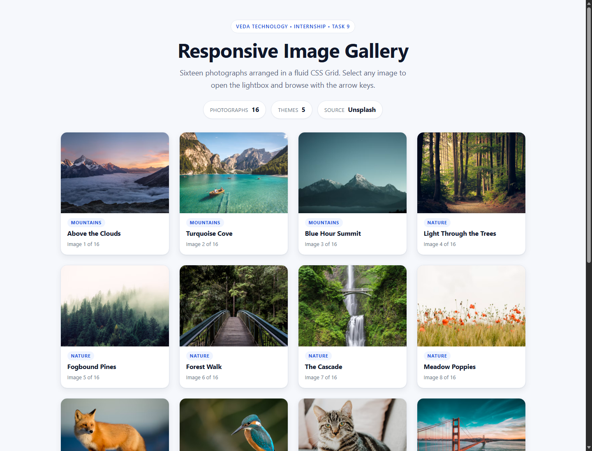
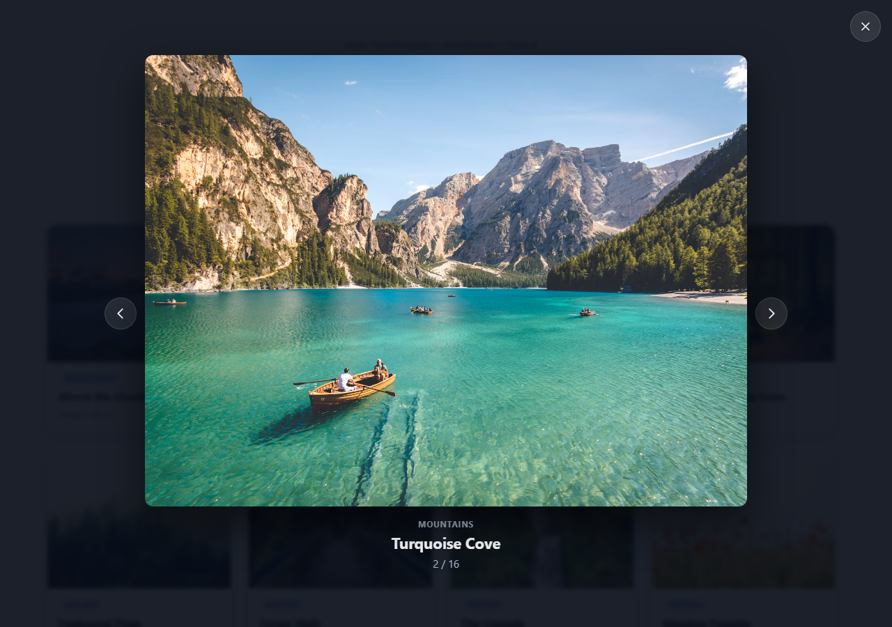
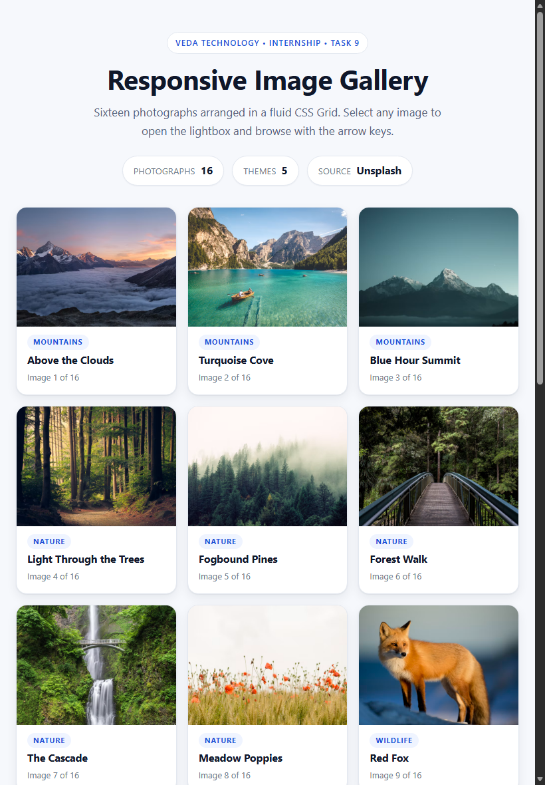
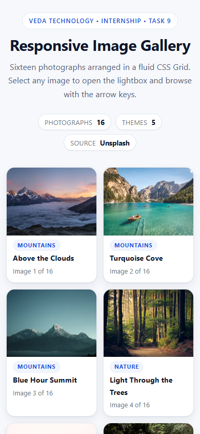
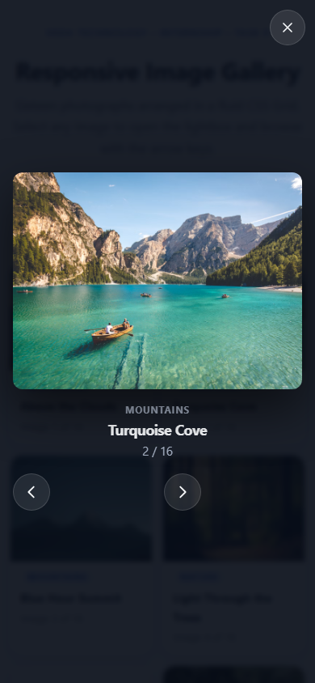

<div align="center">
  

  

  <p><b>Clean • Responsive • Accessible • Keyboard Friendly • No Frameworks</b></p>

  
  
  
  
  
  
  
  

</div>

---

<div align="center">
  
</div>

Responsive Image Gallery of **Abhishek Jadhav** — Web Developer & first-year BCA student at VIIT, Baramati. Built with **HTML5 + CSS3 + Vanilla JavaScript**: no frameworks, no libraries, no build step, and no backend.

> **Internship attribution:** 45-day Web Development Internship at **Veda Technology** — Task 9: Responsive Image Gallery with Lightbox.

<details>
<summary><b>📖 Table of Contents (click to expand)</b></summary>

- [✨ Features](#-features)
- [🛠️ Technologies](#️-technologies)
- [🖼️ How the Gallery Is Built](#️-how-the-gallery-is-built)
- [💡 How the Lightbox Works](#-how-the-lightbox-works)
- [⌨️ Controls Behaviour](#️-controls-behaviour)
- [🛡️ Image Failure Handling](#️-image-failure-handling)
- [📁 Project Structure](#-project-structure)
- [🚀 How to Run](#-how-to-run)
- [🔗 Profile Links](#-profile-links)
- [📜 JavaScript Concepts](#-javascript-concepts)
- [💡 Why CSS Grid, Alt Text and DOM Events Matter](#-why-css-grid-alt-text-and-dom-events-matter)
- [📸 Screenshots](#-screenshots)
- [🧪 Testing Checklist](#-testing-checklist)
- [🌐 Deployment](#-deployment)
- [🖼️ Image Source & Attribution](#-image-source--attribution)
- [⚠️ Limitations](#️-limitations)
- [🔍 Accuracy Notes](#-accuracy-notes)

</details>

## ✨ Features

<div align="center">
  
</div>

- **🖼️ 16 photographs** — well above the 12 required, spread across 5 themes: Mountains, Nature, Wildlife, Architecture and Travel.
- **📐 Fluid CSS Grid** — `repeat(auto-fill, minmax(240px, 1fr))` reflows from 4 columns down to 2 on its own, with no hard-coded column counts.
- **🖼️ Consistent framing** — every card uses a `4 / 3` `aspect-ratio` plus `object-fit: cover`, so photographs of different shapes still line up perfectly.
- **🔍 Lightbox preview** — a native `<dialog>` opened with `showModal()` gives real modal semantics, top-layer rendering and Escape handling from the browser itself.
- **⌨️ Full keyboard control** — `Tab` cycles only inside the preview, `←` / `→` move between images, `Esc` closes, and focus returns to the thumbnail that opened it.
- **🔒 Scroll lock** — the page behind the preview cannot scroll, with scrollbar-width compensation so nothing jumps sideways.
- **🔄 Intentional wrap-around** — Next on image 16 returns to image 1 and Previous on image 1 returns to 16, so the arrows are never dead ends.
- **🛡️ Three-layer failure handling** — two candidate URLs per photograph, then a locally generated SVG placeholder. No broken-image icons, no empty cards.
- **⚡ Lazy loading** — the first four thumbnails load eagerly (above the fold on desktop), the other twelve only load as they scroll into view.
- **💬 Honest messaging** — a failed tile reads "Photograph unavailable" and the lightbox explains itself instead of silently showing nothing.
- **♿ Accessible** — semantic landmarks, one `<h1>`, descriptive `alt` text on every image, labelled controls, a polite live region for the caption, visible `:focus-visible` rings and AA-safe contrast.
- **📱 Responsive** — verified from 320 px up with no horizontal scrolling; on phones the arrow buttons move below the photograph so they never cover it.
- **🎞️ Respectful motion** — `prefers-reduced-motion` collapses every animation, and `forced-colors` support keeps borders visible in Windows High Contrast.

---

## 🛠️ Technologies

| Technology | Use |
|------------|-----|
|  | Semantic landmarks, native `<dialog>`, `figure`/`figcaption`, native `<button>` (`index.html`) |
|  | Custom properties, CSS Grid, Flexbox, `aspect-ratio`, `object-fit`, `clamp()`, keyframes, `::backdrop`, media queries (`style.css`) |
|  | Array dataset, DOM creation, event delegation, capture-phase listeners, `showModal()`, keyboard handling (`script.js`) |
|  | `display: grid`, `auto-fill` + `minmax()`, and grid `areas` for the mobile lightbox |
|  | Native `<dialog>` + `showModal()` / `close()` for modal semantics and top-layer rendering |
|  | Zero dependencies — requirement compliant |
|  | System sans stack (no web-font request) |
|  | Inline control icons, generated fallback placeholder, plus `assets/favicon.svg` |
|  + GitHub Pages | Version control + static hosting |

No React, Bootstrap, Tailwind or jQuery. Badge and typing images above are README-only; the app itself loads **only** the photographs from the image CDN.

---

## 🖼️ How the Gallery Is Built

The markup ships an **empty** grid, and JavaScript fills it from a plain data array:

```js
const ITEMS = [
  {
    id: 'above-the-clouds',
    photoId: 'photo-1506905925346-21bda4d32df4',
    title: 'Above the Clouds',
    category: 'Mountains',
    alt: 'A snow-capped mountain ridge rising above a thick sea of clouds lit by a warm sunset.'
  },
  // ... 15 more
];
```

Each entry carries a stable `id`, the CDN `photoId`, a short `title`, a `category` and a descriptive `alt`. Keeping **data separate from rendering** means the gallery grows by adding one object — no markup changes. The "Photographs 16" and "Themes 5" figures in the header are also derived from the array at runtime, so they can never drift out of sync.

The layout itself is one declaration:

```css
.gallery {
  display: grid;
  grid-template-columns: repeat(auto-fill, minmax(240px, 1fr));
  gap: var(--space-4);
}

.tile__media { aspect-ratio: 4 / 3; }
.tile__image { width: 100%; height: 100%; object-fit: cover; }
```

Every tile is a native `<button>`, not a clickable `<div>`, so keyboard users get `Tab`, `Enter` and `Space` for free:

```html
<button type="button" class="tile"
        aria-label="View image 5 of 16: The Cascade, Nature">
```

Clicking any tile delegates to **one** listener on the grid rather than sixteen separate ones:

```js
dom.gallery.addEventListener('click', function (event) {
  const tile = event.target.closest('.tile');
  if (!tile || !dom.gallery.contains(tile)) return;
  openLightbox(parseInt(tile.dataset.index, 10), tile);
});
```

---

## 💡 How the Lightbox Works

The preview is a native `<dialog>` opened with `showModal()`, so the browser supplies the modal semantics, top-layer rendering and Escape behaviour. The JavaScript manages the state on top of that:

```js
function showItem(index) {
  state.index = wrapIndex(index);
  const item = ITEMS[state.index];
  const sources = buildSources(item, FULL_SIZE);

  dom.image.alt = item.alt;
  dom.image.src = sources[0];
  dom.category.textContent = item.category;
  dom.title.textContent = item.title;
  dom.counter.textContent = (state.index + 1) + ' / ' + ITEMS.length;
}
```

Image, caption and counter are written **together in one pass**, so they can never disagree with each other.

Navigation wraps around on purpose — Next on the last image returns to the first, and Previous on the first returns to the last:

```js
function wrapIndex(index) {
  const total = ITEMS.length;
  if (total === 0) return -1;
  return ((index % total) + total) % total;   // always a valid index
}
```

Opening the preview also locks the page behind it, compensating for the removed scrollbar so the layout does not shift:

```js
state.scrollbarWidth = window.innerWidth - document.documentElement.clientWidth;
if (state.scrollbarWidth > 0) {
  document.body.style.paddingRight = state.scrollbarWidth + 'px';
}
document.body.style.overflow = 'hidden';
```

On close, focus is handed back to the exact thumbnail that opened the preview, so a keyboard user is never dumped at the top of the page.

---

## ⌨️ Controls Behaviour

| Control | Behaviour |
|---------|-----------|
| **Thumbnail** (click, `Enter`, `Space`) | Opens the preview on that photograph |
| **Next** button, or `→` | Advances one image and updates the counter |
| **Previous** button, or `←` | Goes back one image and updates the counter |
| **Close** button, or `Esc` | Closes the preview |
| Click on the **dark overlay** | Closes the preview |
| Click **on the photograph** | Nothing — the preview stays open |
| Click on the **caption** | Nothing — the preview stays open |
| `Tab` / `Shift+Tab` | Cycles only between the three preview controls and never escapes |
| `Home` — not bound | — |

Both the buttons and the arrow keys reach the same `goTo(delta)` function, so keyboard and mouse can never drift apart in behaviour.

---

## 🛡️ Image Failure Handling

Each photograph is **never served from a single URL**. `buildSources()` returns an ordered list:

| Layer | Source | When it is used |
|-------|--------|-----------------|
| 1 | `images.unsplash.com/<photoId>?auto=format&fit=crop&w=…&q=80` | Normal case |
| 2 | the same photograph with a different CDN parameter signature | The first request fails or is rate-limited |
| 3 | A locally generated SVG placeholder showing the image's title | Every URL failed — works with no network at all |

`load` and `error` events do **not** bubble, so they are captured on the container instead:

```js
dom.gallery.addEventListener('error', handleImageError, true);   // capture = true
```

One capture-phase listener per container means there is never a duplicate binding, no matter how many images are rendered.

A subtle but real detail: thumbnails fade in through an `is-loaded` class so an image is only visible once it has actually loaded. An image served from the browser cache can finish *before* the listener is attached, so `renderGallery()` also re-checks `img.complete` and reveals those immediately — otherwise such an image would sit invisible at `opacity: 0` forever.

---

## 📁 Project Structure

```text
internship-task-9/
├── index.html                                       # Semantic markup + lightbox <dialog>
├── style.css                                        # Tokens, grid, cards, lightbox, responsive
├── script.js                                        # 16-photo dataset, rendering, lightbox logic
├── README.md                                        # This file
├── Veda_Technology_Task_9_Project_Report.docx       # Internship project report
└── assets/
    ├── favicon.svg                                  # Blue photo-mark favicon
    ├── screenshot-desktop.png                       # Desktop capture (1440 × 1100)
    ├── screenshot-lightbox.png                      # Lightbox open (1280 × 900)
    ├── screenshot-tablet.png                        # Tablet capture (820 × 1180)
    ├── screenshot-mobile.png                        # Mobile capture (390 × 844)
    └── screenshot-mobile-lightbox.png               # Mobile lightbox (390 × 844)
```

All paths are **relative** (`./style.css`, `./script.js`, `./assets/favicon.svg`) for GitHub Pages compatibility.

---

## 🚀 How to Run

<div align="center">
  
</div>

No install or build step. ✨

1. 📂 Open the `internship-task-9` folder.
2. 🖱️ Double-click `index.html` → opens in Chrome / Edge / Firefox.
   - Or right-click `index.html` → **Open with** → your browser.
   - Or serve it: `python -m http.server 8000` → <http://localhost:8000>
   - Or VS Code **Live Server**: right-click `index.html` → **Open with Live Server**.
3. 🎉 Styling loads from `style.css`, logic from `script.js`, icon from `assets/favicon.svg`.

> The photographs are fetched from the Unsplash CDN at runtime, so an **internet connection is required** to see them. With no connection the page still renders completely — every card simply shows the built-in "Image unavailable" placeholder instead of a photo.

Quick syntax check (Node, from the project folder):

```powershell
node --check script.js
```

---

## 🔗 Profile Links

| Profile | Link |
|---------|------|
|  | https://github.com/0xAbhi13 |
|  | https://www.linkedin.com/in/0xabhi13/ |
|  | https://0xabhi13.github.io/MyPortfolio/ |

---

## 📜 JavaScript Concepts

| Concept | Where |
|---------|-------|
| Array of objects as a data model | `ITEMS` — 16 `{ id, photoId, title, category, alt }` entries |
| DOM creation | `buildTile()` creates each `<li><button>` with `createElement` |
| `DocumentFragment` | `renderGallery()` appends all tiles in one insertion |
| Safe DOM writes | `textContent` for titles, categories and counters (never `innerHTML`) |
| `getElementById` | One `dom` object built once for 12 nodes |
| Event delegation | One `click` listener on the grid + `event.target.closest('.tile')` |
| Capture-phase events | `load` / `error` listeners registered with `true`, since they do not bubble |
| State object | `state = { index, isOpen, isClosing, lastFocused, … }` |
| Modulo wrapping | `wrapIndex()` using `((i % total) + total) % total` |
| Native dialog API | `showModal()` / `close()` / the `cancel` event |
| Keyboard handling | One `keydown` `switch` for `ArrowLeft`, `ArrowRight`, `Escape`, `Tab` |
| Focus trap | `trapFocus()` + `getFocusableControls()` cycle inside the dialog |
| Focus restoration | `state.lastFocused.focus()` on close |
| Scroll locking | `overflow: hidden` plus scrollbar padding, restored on close |
| Animation restart | Class removal + forced reflow (`void el.offsetWidth`) |
| Multi-source fallback | `buildSources()` → `advanceToNextSource()` → `placeholderFor()` |
| Data URI generation | SVG placeholder built as a string and `encodeURIComponent`d |
| Timer safety | `setTimeout` / `clearTimeout` backstop the close animation |
| IIFE + strict mode | `'use strict'` wrapper; `window.galleryApp` exposed for console testing |

---

## 💡 Why CSS Grid, Alt Text and DOM Events Matter

**CSS Grid.** A gallery is a two-dimensional problem — rows *and* columns that must stay aligned — which is exactly what Grid solves. `auto-fill` + `minmax()` computes the column count from the available width, so the layout reflows with no hard-coded breakpoints and no JavaScript measuring the screen. Every item lands in the next free cell, so rows stay aligned no matter how long the captions are. Flexbox is still used where it genuinely fits better — the header facts row and the preview control row are one-dimensional.

**Alt text.** `alt` is not decoration; it is the *content* of the image for anyone who cannot see it. A screen-reader user hears *"A red fox standing in snow and looking back over its shoulder."* instead of *"image"*. If an image fails to load, or the connection is slow, the alt text is what remains — which is why a photo-only card with no alt text is an empty box to those users. Alt text should describe what is *in* the picture rather than repeat the caption. Every alt string in this project was written after actually looking at the corresponding photograph. Decorative icons are `aria-hidden="true"` with `focusable="false"` so they are not announced at all — alt text only helps when it is not diluted by noise.

**DOM events.** The grid is generated from data, so the DOM must be built and then made interactive. Event delegation means one `click` listener serves all sixteen tiles, so adding a seventeenth photo adds zero listeners. `load` and `error` need the capture phase because they do not bubble. A single `keydown` `switch` handles `←`, `→`, `Esc` and `Tab` and calls `preventDefault()` so arrow keys do not also scroll the page. The `cancel` event on `<dialog>` is the browser's own Escape signal, intercepted so the close can be animated instead of snapping shut. And focus is managed deliberately — it enters the dialog, stays trapped inside it, and returns to the originating thumbnail — because without that a keyboard user is either stranded or silently returned to the top of the page.

---

## 📸 Screenshots

**Desktop — 1440 × 1100**



**Lightbox — 1280 × 900**



**Tablet — 820 × 1180**



**Mobile — 390 × 844**



**Mobile lightbox — 390 × 844**



---

## 🧪 Testing Checklist

**Real browser — Microsoft Edge 155 (headless, DevTools Protocol): 124 / 124 passed**

- [x] Page loads from `file://`; `style.css` applies and `script.js` executes.
- [x] 16 tiles render, each a native `<button type="button">` wrapping one ``.
- [x] Every image has unique, meaningful `alt` text; every tile has an `aria-label`.
- [x] Grid resolves to 4 / 4 / 3 / 3 / 2 / 2 columns at 1440 / 1100 / 820 / 600 / 390 / 320 px.
- [x] **No horizontal scrolling at any of those six widths**; every tile inside the viewport.
- [x] Every thumbnail keeps an exact 4:3 frame at every width, with `object-fit: cover`.
- [x] All 16 photographs downloaded from the CDN; 4 eager + 12 lazy.
- [x] Clicking a thumbnail opens a real modal (`dialog.open` and `:modal` both true).
- [x] Counter reads `5 / 16` for the fifth photo, with matching title, category and alt text.
- [x] Next / Previous buttons and `→` / `→` / `←` all step the counter correctly.
- [x] Next on image 16 wraps to 1; Previous on 1 wraps to 16; stable over 19 advances.
- [x] `Esc` closes; the close button closes; clicking the dark overlay closes.
- [x] Clicking **on the photograph** does not close it; clicking the caption does not close it.
- [x] Background scrolling locked while open and restored on close, padding removed.
- [x] Focus returns to the exact thumbnail that opened the preview.
- [x] `Tab` cycles only between the three controls and never escapes to the page.
- [x] Open → navigate → close repeated 4/4 times with no leftover state.
- [x] Forced image failure: both URLs tried, then the placeholder drawn — no broken icon, card keeps its size.
- [x] `prefers-reduced-motion: reduce` collapses animation to `0.000001s` and the modal still closes.
- [x] At 390 px the lightbox has no horizontal scroll and all three buttons are ≥ 44 px.
- [x] Previous sits left of the photo, Next sits right of it, neither overlaps, photo centred.
- [x] Favicon loads from the local relative path.
- [x] **No uncaught exceptions and no console errors.**

**Static and logic suite — Node.js 24: 97 / 97 passed**

- [x] Doctype, `lang`, charset, viewport, exactly one `<h1>`, meta description, semantic landmarks.
- [x] Every `<button>` declares `type="button"`; no inline `on*` handlers; no inline `<script>` blocks.
- [x] No `eval()`, no `new Function()`, no `innerHTML`, no `document.write`; strict mode + IIFE.
- [x] Every `getElementById()` target in `script.js` exists in the HTML.
- [x] All linked local files exist and all paths are relative.
- [x] CSS: custom properties, `display: grid`, `auto-fill` + `minmax()`, `object-fit` cover **and**
      contain, media queries, `prefers-reduced-motion`, `:focus-visible`, `::backdrop`, balanced braces.
- [x] Dataset: 16 items, no duplicate ids, titles, alt text or photo ids, all 5 themes present.
- [x] **Live HTTP check: all 16 photograph URLs returned 200 with a valid `image/*` body.**
- [x] `node --check script.js` passes.

**Bugs found and fixed during testing**

| Bug | Cause | Fix |
|-----|-------|-----|
| Tab escaped the lightbox onto the page | Handler only *corrected* focus after it had already left | Explicit focus trap cycling the dialog's controls |
| Both arrow buttons sat left of the photo | `next` button was written before `<figure>` | Moved `next` after the figure |
| Arrow buttons stacked vertically on mobile | `flex-direction: column` + `order` | Grid `areas`, keeping one DOM order for both layouts |
| Cached thumbnails could stay invisible | `load` listener attached after render; image already complete | Re-check `img.complete` after rendering |
| Skip link moved focus nowhere | Targeted a `<ul>`, which is not focusable | `id` moved to the `<section>` with `tabindex="-1"` |

**Not verified here:** Firefox and Safari behaviour, real touch gestures on a physical phone, and actual
screen-reader output (NVDA / Narrator / VoiceOver). Automated checks confirm the ARIA attributes and
focus behaviour are correct, but cannot prove how a given screen reader announces them.

---

## 🌐 Deployment

**GitHub Pages:**

```powershell
Set-Location "<path-to>\internship-task-9"
git init -b main
git add index.html style.css script.js README.md Veda_Technology_Task_9_Project_Report.docx assets
git commit -m "Task 9: Responsive Image Gallery with lightbox (HTML + CSS + JS)"
git remote add origin <your-repository-url>
git push -u origin main
```

Then GitHub → **Settings → Pages → Deploy from a branch → `main` / root** → GitHub shows your live URL.

> Keep `index.html`, `style.css`, `script.js`, and `assets/` together with relative links so Pages
> resolves them correctly. The repository URL above is a placeholder — replace it with your real repo.
> **Nothing has been committed or pushed yet, and no repository has been created**; the commands are
> provided for the submission step only.

---

## 🖼️ Image Source & Attribution

All 16 photographs are served from the **Unsplash** image CDN (`https://images.unsplash.com/`) using
their standard public photo URLs.

- Unsplash home: <https://unsplash.com>
- Unsplash licence: <https://unsplash.com/license> — free to use with no attribution required, though
  it is credited here as good practice.

The photographs remain the property of their respective Unsplash photographers. This project is an
educational exercise for a Veda Technology internship and is not endorsed by Unsplash.

---

## ⚠️ Limitations

- **An internet connection is required** to display the photographs — they load from the CDN at runtime.
  Offline, the gallery still renders but every card shows the "Image unavailable" placeholder by design.
- **The fallback URLs are retries of the same photograph**, not mirrors on a different provider. They
  cover a failed or rate-limited request; they cannot help if Unsplash is unreachable entirely, which
  is what the local SVG placeholder is for.
- **Wrapping, not clamping** — Next on the last image returns to the first. Intentional and consistent,
  but it does mean you cannot stop at the end of the set.
- **No preloading of neighbouring images**, so the first frame after a very fast arrow-key press may
  take a moment on a slow connection.
- **No filtering, search, favourites or download** — out of scope for Task 9; controls were kept
  minimal on purpose.
- **No data is stored or transmitted.** The gallery is entirely client-side.

---

## 🔍 Accuracy Notes

- Every test result quoted above came from suites actually executed against these files — no invented numbers.
- Four genuine application bugs were found by testing and fixed (see the table in the Testing Checklist);
  several other initial failures were traced to bugs in my own test harness, not in the app, and the
  harness was corrected.
- Alt text was written only after viewing each photograph, so no description is guessed.
- Photographs are attributed to Unsplash and their photographers; no image is claimed as original work.
- Skills are presented as *learning/using* at internship level.
- The app makes no requests other than the photographs; README badges and typing images are documentation-only.

---

<div align="center">

  

  <p><sub>Veda Technology Internship — Task 9: Responsive Image Gallery • HTML5 • CSS3 • Vanilla JavaScript ✨</sub></p>

</div>
